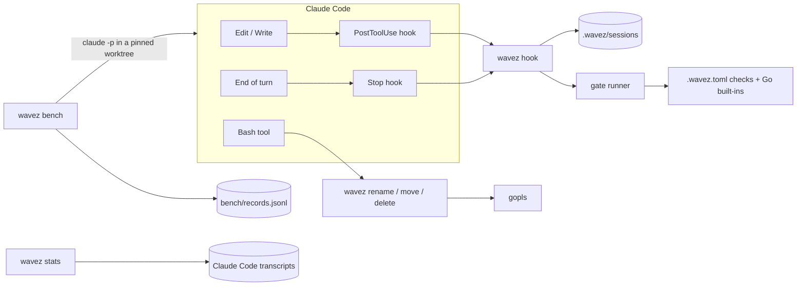

# Wavez design

Wavez is the deterministic layer under a coding agent. It does not run a model.
It runs beside one, on the parts of the work that never needed a model: which
checks to run after a change, how to rename a symbol, and whether any of this
made the agent cheaper.

The first design is archived in [`_ai_/v1/`](_ai_/v1/DESIGN.md), along with
the measurements that ended it.

## Why the first design was replaced

The first wavez owned the whole loop: daemon, TUI, model router, scheduler,
sandbox, 122,000 lines of Go. Its own replay records (360 runs, 2026-08-21 to
09-03, `_ai_/bench/replay/`) said what that bought:

| Measure | Value |
|---|---|
| Runs that completed with every check passing | 129 of 360 |
| Same, on the local tier | 54 of 194 |
| Turns that changed the tree | 15% |
| Turns spent on retrieval | 53% |
| Turns spent on the harness itself | 27% |

Those tasks named the file to change, on the repository the harness was
written against. Claude Code and Pi do better on harder work with a model the
old loop was not designed around, and the old benchmark never ran against
either, so every optimization was measured against wavez's earlier self.

Two parts of it were measurably good and did not depend on owning the loop.
Gates took untargeted `go build`/`go test` sweeps through the shell from 8 to
0 across eight alternating lanes. Name-based refactors turned a rename across
a module into one call. This design keeps those, adds the comparison the old
one refused to make, and drops the rest.

## Thesis

Let the best available harness and model do the judgment. Do the predictable
parts deterministically, deliver them through the harness's own extension
points, and prove each one against the harness running alone.

## Shape

One binary, no daemon, no model calls, no state outside the project.

| Package | Responsibility |
|---|---|
| `internal/config` | Loads the optional `.wavez.toml`. A Go module gets the built-in checks with no file at all |
| `internal/gate` | Selects checks from the changed files, runs fixers first, runs the checks, and reports pass, fail, or abstained |
| `internal/reduce` | Cuts tool output down to the lines that carry a diagnostic |
| `internal/session` | What one agent session changed, including through the shell, and what the gates last said about it |
| `internal/hook` | Translates Claude Code hook events into gate runs and gate reports into hook responses. `wavez init` writes the settings |
| `internal/refactor` | `rename`, `move`, and `delete` for Go declarations, located with `go/ast` and applied with `gopls` |
| `internal/bench` | Runs a pinned task in a throwaway worktree under a harness, checks the result, appends a record, and reports arms side by side |
| `internal/transcript` | Reads a Claude Code session transcript and attributes its turns |

## Gates

A gate is a check the agent never asks for. Two stages:

- **edit** runs after every write and has to be near-instant. The built-in
  formats the file. If bytes changed the agent is told its view is stale, and
  otherwise it hears nothing
- **stop** runs when the agent tries to end its turn, over everything the
  session changed. The Go built-ins are build, test, and lint over the
  changed packages and their importers. A failure blocks the stop and hands
  the agent the reduced output

Rules the first design paid to learn:

- **Silence on a pass.** A passing gate costs the agent zero tokens
- **A check that could not run abstains, and only the person hears it.** A
  missing binary, a timeout, or a toolchain error is `NOT CHECKED`, never a
  failure, and it goes to the person as a system message. The first live run
  handed that line to the agent, which spent two turns looking for a linter. The old
  loop handed a gate's own broken command to the model as work, and a run
  spent fourteen of fifteen turns on a defect that did not exist
- **A finding with a mechanical fix never reaches a turn.** A check's `fix`
  command runs first
- **A repeated failure stops blocking.** The same failure three rounds in a
  row releases the agent and tells the person, because a failure that
  predates the session is not the session's to fix
- **Unchanged work is not rechecked.** A stop over the change set the gates
  already passed runs nothing

A project in another language declares its checks in `.wavez.toml`: a name,
the globs that select it, a command, an optional fixer, whether it blocks or
advises, and its stage.

## Refactors

`wavez rename`, `move`, and `delete` take names. The agent reaches them
through the shell, so they cost no tool schema, and a skill whose description
is one sentence tells it when to. Each one restores the files it touched if
the affected packages no longer build, and each refusal says what to do next:
an ambiguous name lists the candidates, and a delete that would orphan a
caller names the caller.

## Benchmark

`wavez bench run <task> --arm baseline|wavez` checks out the task's pinned
commit into a throwaway worktree, runs the harness headless, evaluates the
task's checks, and appends a record with turns, cost, tokens, wall clock, and
the transcript attribution. `wavez bench report` puts the arms side by side.

- A task pins a commit, so it does not drift with the tree
- The baseline arm is the harness alone. That is the comparison that decides
  whether any part of wavez stays
- Run-to-run variance on one task was 40-70% in turns under the old loop. The
  report says when a difference is inside the noise and refuses to compare
  arms served by different models
- The number the gates exist to move is untargeted sweeps through the shell.
  The transcript attribution counts them

`wavez stats <session>` gives the same attribution for any Claude Code
session, so daily work is measurable without a benchmark run.

## Decisions

- In the context of a loop that lost to Claude Code on its own tasks, facing
  a model gap no harness closes, wavez runs under the harness and gives up
  the loop, accepting that it is useless without one
- In the context of delivering gates, facing a choice between an MCP server
  and hooks, wavez uses hooks, because a hook costs no tokens until it has
  something to say and an MCP tool costs its schema on every turn
- In the context of delivering refactors, facing the same choice, wavez uses
  plain commands and a skill, because the shell is already advertised
- In the context of configuration, facing pkl's evaluator subprocess, wavez
  uses TOML and derives the Go defaults, accepting a less expressive file
- In the context of Go refactors, facing a hand-written LSP client and a
  symbol index, wavez shells out to the `gopls` command, accepting a cold
  start per call in exchange for maintaining neither
- In the context of the sandbox, permissions, threads, scheduling, and the
  TUI, wavez has none, because the harness has its own

## First live runs

One run per arm on `claude-sonnet-5-5`, 2026-11-21, recorded in
`bench/records.jsonl`. Produced by `wavez bench run <task> --arm <arm>
--model sonnet` and read with `wavez bench report`. One run per arm settles
nothing about cost, and the report says so.

| Task | Arm | Checks | Turns | Cost | Wall |
|---|---|---|---|---|---|
| h3 rename | baseline | 6/6 | 4 | $0.119 | 17s |
| h3 rename | wavez, first run | 6/6 | 6 | $0.143 | 34s |
| h3 rename | wavez, after the fix below | 6/6 | 4 | $0.108 | 25s |
| e2 add a method and test | baseline | 2/3 | 7 | $0.115 | 14s |
| e2 add a method and test | wavez | 3/3 | 13 | $0.167 | 65s |

What the transcripts showed:

- **The hooks work end to end.** PostToolUse, Stop, a block, and a release
  all fired in real sessions
- **An abstention sent to the agent is work.** The first h3 run told the
  agent the linter could not load, and it spent two turns on that. Notes now
  go to the person. This is the fix in the table
- **The refactor skill was not used.** Both wavez runs of h3 renamed with
  `sed` and never called `wavez rename`, before and after the description
  was sharpened. The commands pass the same task when called directly, so
  the open problem is getting an agent to reach for them
- **The e2 difference is a pre-existing failure, not a win.** A macOS-only
  test fails on the Linux machine these ran on. The baseline left it failing
  and the gate blocked until the agent skipped it on Linux. That is the gate
  doing its job on a failure the session did not cause, which cost six turns
  and is the first item below

## What is not here yet

- **Pre-existing failures block.** A failing test is not compared against the
  tree the session started from, so a test that was already red holds the
  agent until the round cap. Re-running only the failing tests at the
  baseline, on the failure path, would tell the two apart
- **Nothing makes an agent use the refactor commands.** A skill description
  was not enough in two runs

- Checks for languages other than Go ship as configuration, not as built-ins
- Only Claude Code has a hook adapter. `wavez gate` is harness-neutral, so a
  Pi extension is a small wrapper that has not been written
- The task set is the first design's thirteen tasks, all on this repository
  at its last v1 commit. A task on a project wavez did not write is the next
  thing the benchmark needs
- Cross-package `move`, and extract or change-signature, are not built
