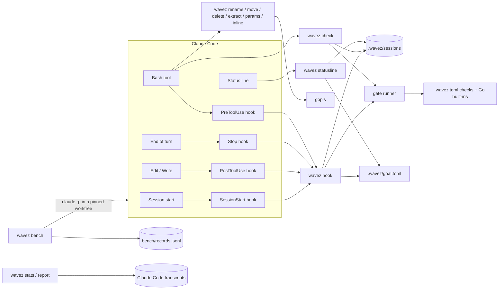

# Wavez design

Wavez is the deterministic layer under a coding agent. It runs beside one, on
the parts of the work that never needed a model: which checks to run after a
change, how to rename a symbol, whether a written goal is met, what the
person needs to look at, and whether any of this made the agent cheaper.

The first design, its research, and its benchmark records were last in the
tree at commit `12b4f17` under `_ai_/`. What it measured that still decides
something here is quoted below.

## Why the first design was replaced

The first wavez owned the whole loop: daemon, TUI, model router, scheduler,
sandbox, 122,000 lines of Go. Its own replay records (360 runs, 2026-08-21 to
09-03) said what that bought:

| Measure | Value |
|---|---|
| Runs that completed with every check passing | 129 of 360 |
| Same, on the local tier | 54 of 194 |
| Turns that changed the tree | 15% |
| Turns spent on retrieval | 53% |
| Turns spent on the harness itself | 27% |

Those tasks named the file to change, on the repository the harness was
written against. Claude Code and Pi do better on harder work with a model the
old loop was not designed around, and the old benchmark never ran against
either, so every optimization was measured against wavez's earlier self.

Two parts of it were measurably good and did not depend on owning the loop.
Gates took untargeted `go build`/`go test` sweeps through the shell from 8 to
0 across eight alternating lanes. Name-based refactors turned a rename across
a module into one call. This design keeps those, adds the comparison the old
one refused to make, and drops the rest.

## Thesis

Let the best available harness and model do the judgment. Do the predictable
parts deterministically, deliver them through the harness's own extension
points, and prove each one against the harness running alone.

## Shape

One binary, no daemon, no state outside the project. It calls a model in one
place, the route question, which is off by default.

| Package | Responsibility |
|---|---|
| `internal/config` | Loads the optional `.wavez.toml`. A Go module gets the built-in checks with no file at all |
| `internal/gate` | Selects checks from the changed files, runs fixers first, runs the checks side by side inside a time budget, reuses a pass whose inputs are unchanged, and reports pass, fail, or abstained |
| `internal/reduce` | Cuts tool output down to the lines that carry a diagnostic |
| `internal/session` | What one agent session changed, including through the shell, the tree it started from, and what the gates last said |
| `internal/hook` | Translates Claude Code hook events into gate runs and gate reports into hook responses. `wavez init` writes the settings |
| `internal/goal` | Checks a written goal with code: a test passes, a pattern is present or absent, a file exists, a command exits 0 |
| `internal/statusline` | Renders the status line: what needs the person first, then progress |
| `internal/report` | Renders one session, or the benchmark records, as a self-contained HTML page |
| `internal/refactor` | `rename`, `move`, `delete`, `extract`, `params`, and `inline` for Go, located with `go/ast` and applied with `gopls` |
| `internal/decide` | Asks a closed-set question: the caller's rules first, a small model second, the fallback when anything goes wrong |
| `internal/route` | The one question so far: is this prompt direct work, exploration, or work to split |
| `internal/bench` | Runs pinned tasks in throwaway worktrees under a harness, arms interleaved, and reports them side by side with a significance test |
| `internal/transcript` | Reads a Claude Code session transcript, attributes its turns, and lays them out as a timeline |

## Gates

A gate is a check the agent never asks for. The stop stage is off unless a
project sets `stop_checks = true`, because the one paired run found it made
sessions half again as long without making them cheaper or more often right.
A project turns it on where a failure caught before CI is worth that wait,
and should not where a check is slow, such as a whole-program type check.
With it off, the same checks are one command the agent is told about,
`wavez check`. Two stages:

- **edit** runs after every write and has to be near-instant. The built-in
  formats the file. If bytes changed the agent is told its view is stale, and
  otherwise it hears nothing
- **stop** runs when the agent tries to end its turn, over everything the
  session changed, including files a shell command wrote. The Go built-ins
  are format, build, test, and lint over the packages the changed files
  select and their importers. A changed non-Go file selects the package of
  its directory, so a fixture edit runs the tests that read it. Importers
  are compiled only when a changed file differs outside its function
  bodies, since a rewritten body leaves them the same declarations to
  compile against; their tests still run, or the ones a selector picks. A
  failure blocks the stop and hands the agent the reduced output

`wavez check` is that stop stage run from the shell. It reads which session
it is in from `WAVEZ_SESSION`, which the SessionStart hook appends to the
file Claude Code names in `CLAUDE_ENV_FILE`, and checks what the session
changed against the tree it started from. Outside a session it checks what
git, or jj in a workspace git cannot read, reports as changed. It is named
`check` because the sentence that points at it then needs no gloss, and
`gate` stays as an older name. It prints one line on a pass, the reduced
failure on a failure, and exits 0, 1, or 3 for passed, failed, and could not
run.

Rules, most of them paid for:

- **Silence on a pass.** A passing gate costs the agent zero tokens
- **One sentence at the start.** With the stop checks off, SessionStart
  says "Check your work with `wavez check`, not whole-project build, test,
  lint, or type-check commands." (96 bytes; the narrowest-command sentence
  it replaced was 212). A project with no check to run keeps that older
  sentence. With the stop checks on, it says they run by themselves. Either
  way the aim is fewer whole-project runs, which are the slowest thing a
  session does. The run below could not tell the sentence's arms apart, so
  it is kept for the machine time it should save and is not shown to save
  turns. `announce = false` or `WAVEZ_ANNOUNCE=0` turns it off
- **A check that could not run abstains, and only the person hears it.** A
  missing binary, a process-level timeout, or a toolchain error is
  `NOT CHECKED`, never a failure. It is recorded as neither a pass nor a
  failure, and is not run again until the tree changes. The first live run
  handed that line to the agent, which spent two turns looking for a linter
- **The stop gate has a budget.** One stop gets 150 seconds, half of the five
  minutes after which the prompt cache goes cold. `go test` gets two fifths
  of it as its own `-timeout`, so a hanging test is named as a failure
  instead of holding the turn until the harness gives up. `wavez check` gets
  100 seconds, inside the shell tool's two-minute limit
- **Checks that only read run side by side.** Fixers rewrite files, so they
  run first and one at a time. Then build and test (one job, since a build
  failure is reported alone), lint, and each configured check run at most
  `parallel` at once, one per CPU by default, in a fixed report order. A
  check with `exclusive = true` runs with nothing beside it
- **A finding with a mechanical fix never reaches a turn.** A check's `fix`
  command runs first
- **A failure that predates the session does not block.** On a failing stop
  the gate re-runs only the failing tests against the tree the session
  started from, in a throwaway worktree. A test that fails there twice goes
  to the person as `ALREADY FAILING`. One that fails and then passes on the
  same tree is `FLAKY` and does not block. A baseline that does not build
  cannot be compared, so nothing is demoted on its word. Lint is not compared
- **A repeated failure stops blocking.** The same failure three rounds in a
  row, or six blocks in one turn, releases the agent and tells the person.
  Six is below the harness's own silent cap of eight
- **Unchanged work is not rechecked.** A stop over a change set the gates
  already passed, or already could not check, runs nothing. Within a
  changed set, a pass is reused by content: lint per package, keyed on the
  linter, go and their environment, the linter config, go.mod and go.sum,
  and every file of the package and of the module packages it imports, with
  the cache off where a vendor directory, a go.work, or a local replace
  reaches code that key cannot see; a configured check only when it
  declares `inputs`, keyed on its commands, PATH, the files it was handed,
  and every project file its globs or inputs match. Keying only the files a
  check is handed is not enough: a changed config or lockfile would then
  reuse a stale pass. Build and test rely on go's own caches. A failure or
  an abstention is never reused
- **Lint covers the changed packages, not their importers.** A finding in
  an importer would sit in a file the change did not touch, which is never
  reported. On Hatchet, linting `pkg/enums` after an edit took 3 seconds and
  adding its 36 direct importers took 46-53
- **Test selection has a seam and no selector.** `gate.Selector` names the
  tests a change can affect. Only a selection that says it is complete
  narrows the test run; any other answer runs every test of the affected
  packages

A project in another language declares its checks in `.wavez.toml`: a name,
the globs that select it, a command, an optional fixer, whether it blocks or
advises, its stage, and optionally its inputs and whether it is exclusive. A
type check stays narrow by passing `{files}` or by being declared once per
project, with globs that select only that project.

In a jj workspace colocated with git, git sees the working-copy changes and
everything above works. In one whose git store is inside `.jj`, the root is
found by `.jj`, the changed files come from `jj diff --name-only`, and a
session's baseline is the working-copy commit id at its start, diffed with
`jj diff --from`. Such a workspace has no git tree to compare a failure
against, so a failure there blocks with a note.

### Tests that reach the change

A project that keeps a `.detest` directory, with `detest` on PATH, has its
test check narrowed: `detest select --worktree` reads a trace of which
functions each test executes and names the tests that reach the session's
uncommitted change, and `go test` runs those alone. Without it the test
check runs every test of the changed packages and their importers, which is
the slow part: 130 seconds warm for a widely imported Hatchet package. When
detest cannot trust its selection (no trace, a stale one, a dependency or
test-config change) or fails, every test runs as before. A selection is
never allowed to pass a change on a guess.

### Where the prompt's names are

Most sessions open with a search for a name the prompt already gave. With
`locate = true` the UserPromptSubmit hook does that lookup with `git grep`
before the model starts: for each identifier in the prompt, the file and
line that declares it, the test files beside it that mention it, and for Go
the command that tests its package. It says nothing for a name declared
nowhere, or in more than two places unless the prompt names the file, and
nothing for a capitalized constant, which is as often a word of prose. On
Hatchet it answers in under half a second. It is off by default until the
`wavez-locate` arm shows it saves a turn, since the lines it adds are paid
for on every later turn.

### Checks ahead of the question

A harness can only check when the agent asks or when the turn ends, and
either way somebody waits. Wavez sits under the harness and sees every
write, and the machine is idle while the model generates its next step.
`warm = true` uses that time: each write starts `wavez warm`, a detached
process at low priority that runs the session's stop-stage checks with the
fixers off and throws the report away. What it leaves is the compiler's
cache, the test results go keeps, the lint cache, and the passes wavez
keeps, so the run somebody does wait for, at a stop or from `wavez check`,
mostly reads answers back. A session's start does the same for the module's
packages, which a tree under a new path compiles from nothing.

One warm run per session is alive: it holds a lock on a file beside the
session's state, a newer run asks it to end, and a stop that is about to
run the checks waits for it instead of doing the same work beside it. It
records nothing in the session, so a pass is still only what a run that
was asked for found, fixers included. It is off by default and has no
benchmark yet; the `wavez-warm` arm is the stop checks with it on.

### Checks before a commit

`commit_checks = true` makes the PreToolUse hook hold a shell command that
commits or pushes, through git or jj, while the session's changes have not
passed `wavez check`. A run of `wavez check` inside a session records its
pass or its abstention in the session, the way a stop that ran the checks
would, so the hold lifts by itself and the end-of-turn line says what was
checked. Each change set is held once, and the same command sent again runs.
It is off by default and has no benchmark. The reason for it is a workspace
with no commit hook, which is every jj workspace, and a hook that checks the
whole project where a targeted run would do.

## What the person sees

The agent is told as little as possible. The person is told what needs them,
through channels that cost the agent no tokens.

- **A goal that code can check.** `.wavez/goal.toml` holds a sentence and
  conditions. No model judges it. At the end of a turn the conditions run,
  cached by tree. With `block = true` an unmet goal holds the turn under the
  gates' own bounds, and the agent is told only which conditions are unmet. A
  condition that could not be checked never blocks
- **One line at the end of a turn**, through the Stop hook's `systemMessage`:
  files changed, what the checks made of them, goal progress, and any test
  the session skipped or removed. The same line is not shown twice
- **A skipped or removed test is flagged, not blocked.** An agent can get
  past a failing gate by adding `t.Skip`, and one benchmark session did. Code
  cannot tell that from a skip with a reason, so the person decides
- **A status line** from `wavez statusline`, which reads files and starts no
  process. Checks the gates gave up on, checks that could not run, and a
  context window past 80% come first and in red
- **A page per session** from `wavez report`: what needs the person, a
  timeline of steps by kind, where the turns and tokens went, and a waste
  list. Each waste row has a button that copies a sentence to paste into the
  next prompt or into project instructions. The page is static, so copying
  is all a button can do

## Refactors

`wavez rename`, `move`, and `delete` take names. The agent reaches them
through the shell, so they cost no tool schema, and a skill whose description
is one sentence tells it when to. A refactor that adds a build error restores
the files it touched. A tree that was already broken is tolerated as long as
no error is added. Each refusal says what to do next: an ambiguous name lists
the candidates, and a delete that would orphan a caller names the caller.
`--dry-run` shows the edit without making it. After a rename, uses in files
the build excludes (another platform, a build tag) are listed, since `gopls`
does not see them.

`wavez extract`, `params`, and `inline` are the gopls code actions that
work from its command line, and each refuses what gopls gets wrong
there, since those results compile and the build check passes them:

- **extract** takes a line range and selects the whole statements of one
  block, refusing a range that cuts one. gopls names the result
  `newFunction`, so a rename follows. A `defer` is refused, because it would
  run when the new function returns, and so is a bare `break` whose loop or
  switch is outside the range, which gopls rewrites into a `break` of the
  switch it generates. A variable the range declares and the code after it
  only updates (`sum -= x`) is not returned, which does not compile, so the
  build check catches it
- **params** rewrites the parameter list by renaming the `func` keyword to
  the new signature, which is how gopls's command line reaches its
  change-signature refactoring. It removes and reorders, and gopls cannot
  add. A removed argument that holds a call is refused, because gopls
  deletes the argument and the call's effect with it. Syntax cannot tell a
  conversion to a named type from a call, so that is refused too
- **inline** runs gopls's inliner once per call on the range and formats
  the file, which the inliner leaves as printed

A skill description did not make an agent use them, so a rule does. A
PreToolUse hook reads each shell command. A `sed -i`, `perl -pi`, or
`gofmt -r` that swaps one identifier for another across Go files is denied
once per session when the files' own package declares the old name and not
the new, with the `wavez rename` command to run. A second attempt is allowed,
because the agent may have a reason.

## Decisions by a model

`internal/decide` is taken from how HQ does it:

- The set of answers is declared in code, so a model can only pick among
  what code already permits, and a model-written string never reaches the
  agent
- The caller's rules answer first. A rule stays only while it is right on
  every line of a labeled corpus
- A small non-thinking model behind an OpenAI-compatible endpoint answers
  what no rule could. The API key is sent only to the endpoint named in the
  person's own environment, never to one a project file names
- Anything that goes wrong returns the fallback, which is the behavior
  before the question existed

The one question so far is the route. With `route = true`, a
UserPromptSubmit hook picks `direct`, `explore`, or `coordinate` and hands
the agent one fixed sentence, or says nothing. It is off by default and
likely to stay off. On 80 prompts the rules were not written against
(`bench/route_holdout.jsonl`):

| Who answers | Right | Of |
|---|---|---|
| Rules alone, silent otherwise | 28 | 80 |
| Rules, then `claude-haiku-5-5` through `claude -p` | 59 | 80 |

The rules answered 2 of the 80. Haiku answered 74 of the other 78 and was
wrong on 18, mostly follow-ups such as "fix it" that it called exploration.
A hint that is wrong one time in four, on a question the agent already
answers for itself, has not earned a benchmark run.

## Benchmark

`wavez bench run --all --arm baseline,wavez,wavez-quiet` checks out each
task's pinned commit into a throwaway worktree, runs the harness headless,
evaluates the task's checks, and appends a record. `wavez bench report` puts
the arms side by side, and [bench/README.md](bench/README.md) says how to
read it.

- A task pins a commit, so it does not drift with the tree
- The baseline arm is the harness alone. That is the comparison that decides
  whether any part of wavez stays
- Arms are interleaved in a shuffled order, because an arm that runs second
  inherits the first one's warm prompt cache
- Run-to-run spread on one task was 40-70% in turns. Five runs an arm on one
  task cannot show an effect of a fifth at that spread, so the report pairs
  arms by task across the whole set and tests the per-task ratios
- Records carry a hash of the wavez binary and the run's flags, and runs
  that differ in either are never compared
- A failed or timed-out run is counted as that and kept out of the medians

`wavez stats <session>` gives the turn attribution for any Claude Code
session, so daily work is measurable without a benchmark run.

## Decisions

- In the context of a loop that lost to Claude Code on its own tasks, facing
  a model gap no harness closes, wavez runs under the harness and gives up
  the loop, accepting that it is useless without one
- In the context of delivering gates, facing a choice between an MCP server
  and hooks, wavez uses hooks, because a hook costs no tokens until it has
  something to say and an MCP tool costs its schema on every turn
- In the context of delivering refactors, facing the same choice, wavez uses
  plain commands and a skill, because the shell is already advertised
- In the context of telling the person something, facing the agent's
  context as the nearest channel, wavez uses `systemMessage`, the status
  line, and a page, because text in the context is paid for on every later
  turn
- In the context of a goal, facing a model as the obvious judge, wavez
  accepts only conditions code can check, giving up goals that cannot be
  written that way
- In the context of the status line, facing `wavez init` as the place to
  install it, wavez prints the settings and leaves them to the person,
  because a status line is a personal choice and `.claude/settings.json` is
  shared
- In the context of configuration, facing pkl's evaluator subprocess, wavez
  uses TOML and derives the Go defaults, accepting a less expressive file
- In the context of Go refactors, facing a hand-written LSP client and a
  symbol index, wavez shells out to the `gopls` command, accepting a cold
  start per call in exchange for maintaining neither
- In the context of the sandbox, permissions, threads, scheduling, and the
  TUI, wavez has none, because the harness has its own
- In the context of Windows, facing `flock` and process groups, wavez
  supports Linux and macOS only

## What has been measured

Wavez does not make Claude Code cheaper on this task set, and it makes it
slower. One paired run on `claude-sonnet-5-5`, 2026-11-24: all seventeen
tasks once under each arm, arms interleaved, 51 sessions, appended to
`bench/records.jsonl`. Each row is the geometric mean of the per-task ratios
against the baseline, with `p` from the paired permutation test.

| Arm | Passed | Turns | Cost | Wall clock | Sweeps per task |
|---|---|---|---|---|---|
| baseline | 12 of 17 | | | | |
| wavez | 11 of 17 | 1.08x, p 0.36 | 1.05x, p 0.15 | 1.51x, p 0.001 | -0.12, p 0.63 |
| wavez-quiet | 12 of 17 | 1.09x, p 0.33 | 1.07x, p 0.11 | 1.61x, p 0.001 | +0.12, p 0.75 |

- **Turns and cost are inside the noise**, leaning the wrong way
- **Wall clock is half again as long, and that is outside the noise.** The
  stop gate runs build, test, and lint while the baseline simply ends
- **There were few sweeps to remove.** A whole-project build or test ran in
  5 of 17 baseline sessions, 2 with wavez, and 4 with wavez and no
  sentence, which is too few to tell apart
- **The SessionStart sentence changed nothing measurable.** `wavez` against
  `wavez-quiet` is 0.99x turns, p 0.91
- **The gates did not raise the pass rate.** The checks that failed were
  ones a build and test of the changed packages do not catch

These rows are the stop checks on, which was the default when the run was
made and is the `wavez-gates` arm now.

With the stop checks off and the targeted-checks sentence in their place, a
second paired run on the nine Hatchet tasks (Go, Python, TypeScript, same
model and day, 18 sessions) found no difference in either direction: both
arms passed 9 of 9, wall clock 1.01x (p 0.94), cost 1.07x (p 0.28), turns
1.22x (p 0.19). The wall-clock penalty is gone, and nothing is gained yet.

A third paired run asked whether `wavez check` with test selection pays on
changes to widely imported packages: six tasks in `bench/tasks_hatchet_wide.toml`,
each a small edit to a package that 95 to 252 of Hatchet's 356 packages
import, baseline against wavez with a detest trace, same model and day, 12
sessions. It does not. Both arms passed 6 of 6, and wavez took 3.95x the
wall clock (p 0.031), 1.11x the cost (p 0.062), and 1.29x the turns
(p 0.25). The baseline never ran a whole-project command: it tested the one
package it changed and stopped, in 13 to 41 seconds. The wavez arm ran
`wavez check`, which recompiled every importer of the changed package, about
45 seconds in a fresh worktree, to guard against a break none of these edits
could cause. The run is what led to compiling importers only when a
declaration changed.

The same six tasks again with that change, same model and day: both arms
6 of 6, turns 1.03x (p 0.84), cost 1.01x (p 0.94), wall clock 2.13x
(p 0.062). Three tasks ran level with the baseline, and three still took
about four times as long. Reading those three sessions found four causes,
all fixed since and none benchmarked since:

- the agent added an import, which counted as a changed declaration and
  compiled every importer again
- the same import made detest select every test that reaches the file, 220
  tests in 15 packages where one reaches the edited function
- a worktree under a new path compiled the module's packages from nothing,
  which `-trimpath` on the build and test commands avoids after the first
  run on a machine
- `wavez check` run from a subdirectory took that directory for the project
  root and checked nothing, which is why one of the level tasks was level

Every session in these runs has the same shape in both arms: search for the
symbol, read the source, read the test, edit both, run the test. Wavez
touched only the last step, and replaced a two-second `go test` of one
package with a slower command. The lookup beside the prompt and the
background runs below are the first parts aimed at the other steps.

One repetition is thin, and these tasks are small enough that the baseline
finishes in three to seventeen turns and rarely runs a whole-project
command, which leaves little to save.

Earlier single runs, also in the records, proved the plumbing: the hooks
fire end to end, a pre-existing failure stopped blocking once the baseline
comparison existed, and `wavez rename` was used once the PreToolUse rule
existed without being cheaper than the baseline's four turns.

Machine time of one `wavez check` over a one-file change, in seconds, one
run each on a 4-CPU Linux box with Go 1.26 and golangci-lint 2.13. Cold is a
fresh build and lint cache; warm-edited is the same after a second edit that
changes the compiled package; unchanged is the same tree again. "Before" is
the runner whose checks ran side by side without a bound or a reused pass.

| Change | Runner | Cold | Warm, edited | Unchanged |
|---|---|---|---|---|
| wavez `internal/reduce` (6 packages) | before | 74 | 50 | 1.1 |
| | after, parallel | 78 | 44 | 1.1 |
| | after, `parallel = 1` | 79 | 54 | 1.5 |
| Hatchet handler (5 packages) | before | 149 | 5.4 | 1.7 |
| | after, parallel | 154 | 5.8 | 1.7 |
| | after, `parallel = 1` | 116 | 7.6 | 1.6 |
| Hatchet `pkg/enums` (255 packages) | before | 256 | 132 | 7.1 |
| | after, parallel | 266 | 133 | 6.5 |
| | after, `parallel = 1` | 259 | 127 | 6.9 |

Each check alone, same changes: build cold 17, 88, and 240; test cold 54,
106, and 259 and warm-edited 50, 4.3, and 133; lint cold 24, 107, and 43 and
warm-edited 1.9, 2.2, and 4.3; format under 0.1 everywhere. What it says:

- **A test run over importers is the cost that is left.** Lint is cheap
  because it skips importers, and build is cheap once the cache is warm.
  `go test` over the 255 importers of a widely used package is two minutes
  on a warm cache, which is what a test selector would remove
- **Selection and a narrower build remove most of it.** The same warm
  edit to `pkg/enums`, a function body rewritten, one run each on the same
  box: 60 seconds and no answer without a trace, since the test check times
  out; 33 seconds with a detest trace, which runs the two tests that reach
  the function; 11 seconds once the importers are compiled only when a
  declaration changed. In a fresh worktree, where nothing of the module is
  in the build cache under that path, the last figure is 26. A warm
  `go test ./...` there is 70
- **Running the checks side by side is not a clear win.** It saved 10 and 2
  seconds warm, and cost 39 seconds cold on Hatchet, where lint and the
  build each type-check from source on four CPUs and sequential lint reads
  the build cache the build just filled. One run each is inside the noise
  for everything but that cold row
- **A reused lint pass saves under half a second here** (1.1 to 0.8 and 2.0
  to 1.7 on an unchanged tree after a comment edit), because golangci-lint
  already caches by package; what remains is `go list` and go's own test
  cache lookup

What the transcripts say about where cost goes: cache reads are 84-98% of
input tokens in every session read, so each turn re-pays for the whole
context. The lever is the number of turns, and above all the turns after the
last edit. Anything wavez adds to the context has to remove a turn to pay
for itself.

## What is not here yet

- **A result on longer tasks, and more than one repetition.** Both paired
  runs are one repetition on small tasks
- **A benchmark since the last four fixes to `wavez check`,** and any
  benchmark of `locate`, `warm`, or `commit_checks`. The `wavez-locate` and
  `wavez-warm` arms exist and have not been run. The reused passes and the
  jj paths are unmeasured on any task set
- **Lint that survives a new path.** golangci-lint keys its cache on file
  paths, so in a fresh worktree it type-checks from source: about 10 of the
  21 seconds `wavez check` takes there on a one-function Hatchet edit
- **A task where the unaided agent checks too much.** On every task so far
  the baseline tested the package it changed and nothing else, so there has
  been nothing for a targeted check to save. A slow whole-program type
  check, or a project whose instructions demand the full suite, is where
  that would show, and no task has one
- **A trace that keeps itself current.** Test selection reads a detest trace
  that a person or a nightly job has to make: 5m25s for Hatchet's 1,848 Go
  tests on four cores. A trace more than fifty commits behind is refused
- **jj against a real binary.** The jj paths are tested against a fake
  `jj`, not against jj itself
- The goal, the end-of-turn line, and the status line have no before and
  after, because they tell the agent nothing unless a goal blocks
- Lint failures and failures that name no test are not compared against the
  baseline, and files git ignores are missing from the baseline tree
- Checks for languages other than Go ship as configuration, not as built-ins
- Only Claude Code has a hook adapter. Codex accepts the same hook contract,
  so a second writer for its settings file is the likely next adapter
- The main task set is seventeen tasks on this repository at its last
  first-design commit. Nine tasks on Hatchet, a project wavez did not write,
  are in `bench/tasks_hatchet.toml`. Neither set has a task long enough for
  a whole-project type check or test run to dominate, which is the case the
  targeted-checks sentence is for
- Cross-package `move` is not built, and neither is adding a parameter:
  gopls cannot add one, and a hand-written rewriter of every call site is
  the cost this design avoids. `extract`, `params`, and `inline` have no
  benchmark task yet, so nothing shows they save a turn
- Ideas with a reason behind them and no code: a one-line pass notice so the
  agent stops verifying by hand, a PreCompact hook that saves the goal and
  the change set, a SubagentStop gate, and a lint baseline by fingerprint
