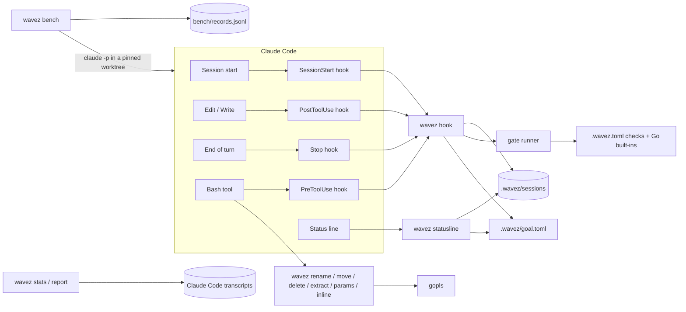

# Wavez design

Wavez is the deterministic layer under a coding agent. It runs beside one, on
the parts of the work that never needed a model: which checks to run after a
change, how to rename a symbol, whether a written goal is met, what the
person needs to look at, and whether any of this made the agent cheaper.

The first design, its research, and its benchmark records were last in the
tree at commit `12b4f17` under `_ai_/`. What it measured that still decides
something here is quoted below.

## Why the first design was replaced

The first wavez owned the whole loop: daemon, TUI, model router, scheduler,
sandbox, 122,000 lines of Go. Its own replay records (360 runs, 2026-08-21 to
09-03) said what that bought:

| Measure | Value |
|---|---|
| Runs that completed with every check passing | 129 of 360 |
| Same, on the local tier | 54 of 194 |
| Turns that changed the tree | 15% |
| Turns spent on retrieval | 53% |
| Turns spent on the harness itself | 27% |

Those tasks named the file to change, on the repository the harness was
written against. Claude Code and Pi do better on harder work with a model the
old loop was not designed around, and the old benchmark never ran against
either, so every optimization was measured against wavez's earlier self.

Two parts of it were measurably good and did not depend on owning the loop.
Gates took untargeted `go build`/`go test` sweeps through the shell from 8 to
0 across eight alternating lanes. Name-based refactors turned a rename across
a module into one call. This design keeps those, adds the comparison the old
one refused to make, and drops the rest.

## Thesis

Let the best available harness and model do the judgment. Do the predictable
parts deterministically, deliver them through the harness's own extension
points, and prove each one against the harness running alone.

## Shape

One binary, no daemon, no state outside the project. It calls a model in one
place, the route question, which is off by default.

| Package | Responsibility |
|---|---|
| `internal/config` | Loads the optional `.wavez.toml`. A Go module gets the built-in checks with no file at all |
| `internal/gate` | Selects checks from the changed files, runs fixers first, runs the checks inside a time budget, and reports pass, fail, or abstained |
| `internal/reduce` | Cuts tool output down to the lines that carry a diagnostic |
| `internal/session` | What one agent session changed, including through the shell, the tree it started from, and what the gates last said |
| `internal/hook` | Translates Claude Code hook events into gate runs and gate reports into hook responses. `wavez init` writes the settings |
| `internal/goal` | Checks a written goal with code: a test passes, a pattern is present or absent, a file exists, a command exits 0 |
| `internal/statusline` | Renders the status line: what needs the person first, then progress |
| `internal/report` | Renders one session, or the benchmark records, as a self-contained HTML page |
| `internal/refactor` | `rename`, `move`, `delete`, `extract`, `params`, and `inline` for Go, located with `go/ast` and applied with `gopls` |
| `internal/decide` | Asks a closed-set question: the caller's rules first, a small model second, the fallback when anything goes wrong |
| `internal/route` | The one question so far: is this prompt direct work, exploration, or work to split |
| `internal/bench` | Runs pinned tasks in throwaway worktrees under a harness, arms interleaved, and reports them side by side with a significance test |
| `internal/transcript` | Reads a Claude Code session transcript, attributes its turns, and lays them out as a timeline |

## Gates

A gate is a check the agent never asks for. Two stages:

- **edit** runs after every write and has to be near-instant. The built-in
  formats the file. If bytes changed the agent is told its view is stale, and
  otherwise it hears nothing
- **stop** runs when the agent tries to end its turn, over everything the
  session changed, including files a shell command wrote. The Go built-ins
  are format, build, test, and lint over the packages the changed files
  select and their importers. A changed non-Go file selects the package of
  its directory, so a fixture edit runs the tests that read it. A failure
  blocks the stop and hands the agent the reduced output

Rules, most of them paid for:

- **Silence on a pass.** A passing gate costs the agent zero tokens
- **One sentence at the start.** SessionStart tells the agent that format,
  build, and tests run by themselves and not to run whole-project commands.
  The first design's sweeps went from 8 to 0 on a sentence this size, not on
  the gates alone. `announce = false` or `WAVEZ_ANNOUNCE=0` turns it off, and the `wavez-quiet`
  benchmark arm exists to measure it
- **A check that could not run abstains, and only the person hears it.** A
  missing binary, a process-level timeout, or a toolchain error is
  `NOT CHECKED`, never a failure. It is recorded as neither a pass nor a
  failure, and is not run again until the tree changes. The first live run
  handed that line to the agent, which spent two turns looking for a linter
- **The stop gate has a budget.** One stop gets 150 seconds, half of the five
  minutes after which the prompt cache goes cold. `go test` gets two fifths
  of it as its own `-timeout`, so a hanging test is named as a failure
  instead of holding the turn until the harness gives up
- **A finding with a mechanical fix never reaches a turn.** A check's `fix`
  command runs first
- **A failure that predates the session does not block.** On a failing stop
  the gate re-runs only the failing tests against the tree the session
  started from, in a throwaway worktree. A test that fails there twice goes
  to the person as `ALREADY FAILING`. One that fails and then passes on the
  same tree is `FLAKY` and does not block. A baseline that does not build
  cannot be compared, so nothing is demoted on its word. Lint is not compared
- **A repeated failure stops blocking.** The same failure three rounds in a
  row, or six blocks in one turn, releases the agent and tells the person.
  Six is below the harness's own silent cap of eight
- **Unchanged work is not rechecked.** A stop over a change set the gates
  already passed, or already could not check, runs nothing

A project in another language declares its checks in `.wavez.toml`: a name,
the globs that select it, a command, an optional fixer, whether it blocks or
advises, and its stage.

## What the person sees

The agent is told as little as possible. The person is told what needs them,
through channels that cost the agent no tokens.

- **A goal that code can check.** `.wavez/goal.toml` holds a sentence and
  conditions. No model judges it. At the end of a turn the conditions run,
  cached by tree. With `block = true` an unmet goal holds the turn under the
  gates' own bounds, and the agent is told only which conditions are unmet. A
  condition that could not be checked never blocks
- **One line at the end of a turn**, through the Stop hook's `systemMessage`:
  files changed, what the checks made of them, goal progress, and any test
  the session skipped or removed. The same line is not shown twice
- **A skipped or removed test is flagged, not blocked.** An agent can get
  past a failing gate by adding `t.Skip`, and one benchmark session did. Code
  cannot tell that from a skip with a reason, so the person decides
- **A status line** from `wavez statusline`, which reads files and starts no
  process. Checks the gates gave up on, checks that could not run, and a
  context window past 80% come first and in red
- **A page per session** from `wavez report`: what needs the person, a
  timeline of steps by kind, where the turns and tokens went, and a waste
  list. Each waste row has a button that copies a sentence to paste into the
  next prompt or into project instructions. The page is static, so copying
  is all a button can do

## Refactors

`wavez rename`, `move`, and `delete` take names. The agent reaches them
through the shell, so they cost no tool schema, and a skill whose description
is one sentence tells it when to. A refactor that adds a build error restores
the files it touched. A tree that was already broken is tolerated as long as
no error is added. Each refusal says what to do next: an ambiguous name lists
the candidates, and a delete that would orphan a caller names the caller.
`--dry-run` shows the edit without making it. After a rename, uses in files
the build excludes (another platform, a build tag) are listed, since `gopls`
does not see them.

`wavez extract`, `params`, and `inline` are the gopls code actions that
work from its command line, and each refuses what gopls gets wrong
there, since those results compile and the build check passes them:

- **extract** takes a line range and selects the whole statements of one
  block, refusing a range that cuts one. gopls names the result
  `newFunction`, so a rename follows. A `defer` is refused, because it would
  run when the new function returns, and so is a bare `break` whose loop or
  switch is outside the range, which gopls rewrites into a `break` of the
  switch it generates. A variable the range declares and the code after it
  only updates (`sum -= x`) is not returned, which does not compile, so the
  build check catches it
- **params** rewrites the parameter list by renaming the `func` keyword to
  the new signature, which is how gopls's command line reaches its
  change-signature refactoring. It removes and reorders, and gopls cannot
  add. A removed argument that holds a call is refused, because gopls
  deletes the argument and the call's effect with it. Syntax cannot tell a
  conversion to a named type from a call, so that is refused too
- **inline** runs gopls's inliner once per call on the range and formats
  the file, which the inliner leaves as printed

A skill description did not make an agent use them, so a rule does. A
PreToolUse hook reads each shell command. A `sed -i`, `perl -pi`, or
`gofmt -r` that swaps one identifier for another across Go files is denied
once per session when the files' own package declares the old name and not
the new, with the `wavez rename` command to run. A second attempt is allowed,
because the agent may have a reason.

## Decisions by a model

`internal/decide` is taken from how HQ does it:

- The set of answers is declared in code, so a model can only pick among
  what code already permits, and a model-written string never reaches the
  agent
- The caller's rules answer first. A rule stays only while it is right on
  every line of a labeled corpus
- A small non-thinking model behind an OpenAI-compatible endpoint answers
  what no rule could. The API key is sent only to the endpoint named in the
  person's own environment, never to one a project file names
- Anything that goes wrong returns the fallback, which is the behavior
  before the question existed

The one question so far is the route. With `route = true`, a
UserPromptSubmit hook picks `direct`, `explore`, or `coordinate` and hands
the agent one fixed sentence, or says nothing. It is off by default and
likely to stay off. On 80 prompts the rules were not written against
(`bench/route_holdout.jsonl`):

| Who answers | Right | Of |
|---|---|---|
| Rules alone, silent otherwise | 28 | 80 |
| Rules, then `claude-haiku-5-5` through `claude -p` | 59 | 80 |

The rules answered 2 of the 80. Haiku answered 74 of the other 78 and was
wrong on 18, mostly follow-ups such as "fix it" that it called exploration.
A hint that is wrong one time in four, on a question the agent already
answers for itself, has not earned a benchmark run.

## Benchmark

`wavez bench run --all --arm baseline,wavez,wavez-quiet` checks out each
task's pinned commit into a throwaway worktree, runs the harness headless,
evaluates the task's checks, and appends a record. `wavez bench report` puts
the arms side by side, and [bench/README.md](bench/README.md) says how to
read it.

- A task pins a commit, so it does not drift with the tree
- The baseline arm is the harness alone. That is the comparison that decides
  whether any part of wavez stays
- Arms are interleaved in a shuffled order, because an arm that runs second
  inherits the first one's warm prompt cache
- Run-to-run spread on one task was 40-70% in turns. Five runs an arm on one
  task cannot show an effect of a fifth at that spread, so the report pairs
  arms by task across the whole set and tests the per-task ratios
- Records carry a hash of the wavez binary and the run's flags, and runs
  that differ in either are never compared
- A failed or timed-out run is counted as that and kept out of the medians

`wavez stats <session>` gives the turn attribution for any Claude Code
session, so daily work is measurable without a benchmark run.

## Decisions

- In the context of a loop that lost to Claude Code on its own tasks, facing
  a model gap no harness closes, wavez runs under the harness and gives up
  the loop, accepting that it is useless without one
- In the context of delivering gates, facing a choice between an MCP server
  and hooks, wavez uses hooks, because a hook costs no tokens until it has
  something to say and an MCP tool costs its schema on every turn
- In the context of delivering refactors, facing the same choice, wavez uses
  plain commands and a skill, because the shell is already advertised
- In the context of telling the person something, facing the agent's
  context as the nearest channel, wavez uses `systemMessage`, the status
  line, and a page, because text in the context is paid for on every later
  turn
- In the context of a goal, facing a model as the obvious judge, wavez
  accepts only conditions code can check, giving up goals that cannot be
  written that way
- In the context of the status line, facing `wavez init` as the place to
  install it, wavez prints the settings and leaves them to the person,
  because a status line is a personal choice and `.claude/settings.json` is
  shared
- In the context of configuration, facing pkl's evaluator subprocess, wavez
  uses TOML and derives the Go defaults, accepting a less expressive file
- In the context of Go refactors, facing a hand-written LSP client and a
  symbol index, wavez shells out to the `gopls` command, accepting a cold
  start per call in exchange for maintaining neither
- In the context of the sandbox, permissions, threads, scheduling, and the
  TUI, wavez has none, because the harness has its own
- In the context of Windows, facing `flock` and process groups, wavez
  supports Linux and macOS only

## What has been measured

Nothing shows wavez makes Claude Code cheaper. The live runs so far are one
run per arm on `claude-sonnet-5-5` on two tasks, recorded in
`bench/records.jsonl`, and they prove the plumbing:

- The hooks fire end to end, and a block and a release both happened in real
  sessions
- A pre-existing failure cost the wavez arm six extra turns until the
  baseline comparison stopped it from blocking
- `wavez rename` was used once the PreToolUse rule existed, and the rename
  task was no cheaper than the baseline's four turns. A rename is the wrong
  place to look for a saving, since the model does one in a few edits
- Whole-project build and test commands still appeared in wavez-arm sessions
  before the SessionStart sentence existed

What the transcripts say about where cost goes: cache reads are 84-98% of
input tokens in every session read, so each turn re-pays for the whole
context. The lever is the number of turns, and above all the turns after the
last edit. Anything wavez adds to the context has to remove a turn to pay
for itself.

## What is not here yet

- **The paired A/B with the SessionStart sentence on and off.** The arms and
  the report exist. The run is the next thing to do, and the sentence's
  default follows its result
- The goal, the end-of-turn line, and the status line have no before and
  after, because they tell the agent nothing unless a goal blocks
- Lint failures and failures that name no test are not compared against the
  baseline, and files git ignores are missing from the baseline tree
- Checks for languages other than Go ship as configuration, not as built-ins
- Only Claude Code has a hook adapter. Codex accepts the same hook contract,
  so a second writer for its settings file is the likely next adapter
- The task set is seventeen tasks on this repository at its last
  first-design commit. A task on a project wavez did not write is the next
  thing the benchmark needs
- Cross-package `move` is not built, and neither is adding a parameter:
  gopls cannot add one, and a hand-written rewriter of every call site is
  the cost this design avoids. `extract`, `params`, and `inline` have no
  benchmark task yet, so nothing shows they save a turn
- Ideas with a reason behind them and no code: a one-line pass notice so the
  agent stops verifying by hand, a PreCompact hook that saves the goal and
  the change set, a SubagentStop gate, and a lint baseline by fingerprint
